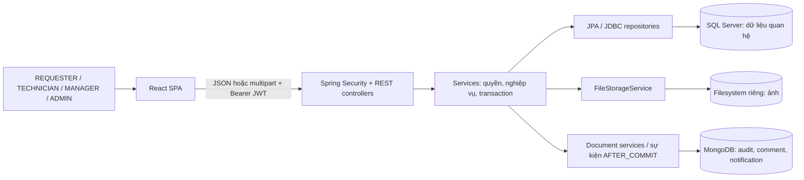
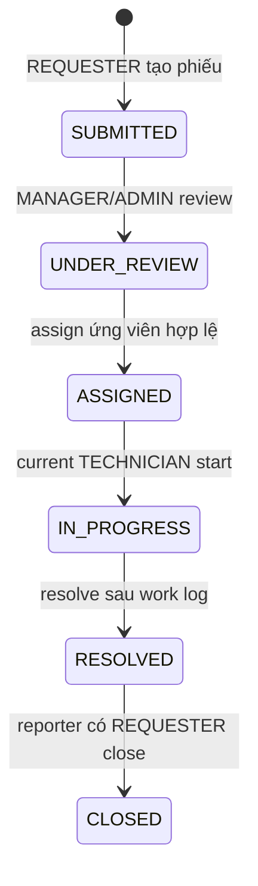
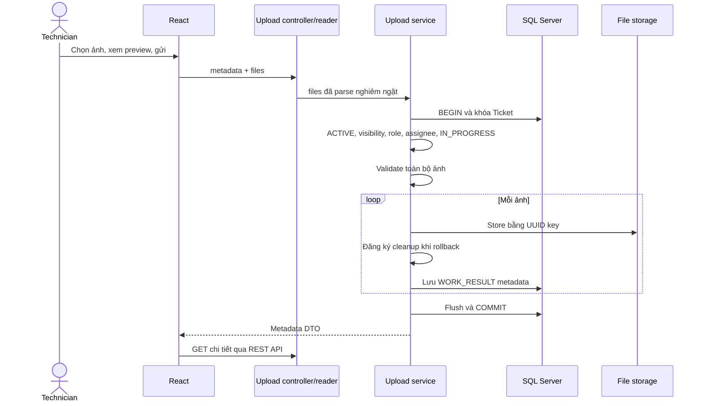

# Kiến trúc Nexora

## 1. Tổng thể

Nexora là modular monolith: một Spring Boot REST API và một React SPA. Các module theo nghiệp vụ nằm trong cùng backend; không có microservice, message broker hoặc distributed transaction.

MongoDB đã có document/repository/service; sơ đồ không khẳng định mọi sự kiện nghiệp vụ đều phát notification hoặc đã có API comment đang bật.

## 2. Tổ chức mã nguồn

| Khu vực                                    | Trách nhiệm                                                       |
| ------------------------------------------ | ----------------------------------------------------------------- |
| backend/.../auth, user                     | Login, JWT, user/role và cấu hình kỹ thuật viên                   |
| backend/.../category                       | Category, form versions, field/option và rule validation          |
| backend/.../ticket                         | Tạo/đọc Ticket, assignment, workflow, log, attachments            |
| backend/.../asset, location                | Thiết bị, địa điểm và lịch sử trạng thái                          |
| backend/.../dashboard                      | Truy vấn tổng hợp theo phạm vi xem                                |
| backend/.../common, config                 | Problem Details, pagination, storage, security, OpenAPI           |
| backend/.../audit, notification, migration | Document persistence và legacy backfill                           |
| frontend/src/app                           | Router, providers và route guards                                 |
| frontend/src/features                      | API clients, hooks, pages, components, schemas của từng nghiệp vụ |
| frontend/src/shared                        | HTTP client, session handling, layout và UI dùng chung            |

Trong backend, dùng controller/dto/entity/document/repository/service khi thực sự cần. Ticket giữ cấu trúc phẳng theo layer; không tạo thêm package workflow/comment lồng nhau chỉ để phân loại.

Frontend: .jsx cho JSX, .js cho module thông thường. API module gửi request; TanStack Query quản lý dữ liệu server/cache; Context giữ phiên đăng nhập. Component không gọi Axios trực tiếp. Filter/page/sort đi qua URL search params khi màn hình hỗ trợ.

## 3. Ranh giới trách nhiệm

- Controller đọc/validate HTTP, gọi service và trả DTO.
- Service kiểm quyền đối tượng, trạng thái, validation nghiệp vụ và transaction.
- Repository truy vấn/lưu dữ liệu; không quyết định action người dùng được phép làm.
- JPA entity giữ dữ liệu và các thao tác domain nhỏ; không serialize trực tiếp thành API.
- Backend là nơi quyết định quyền cuối cùng. Route guard và client validation hỗ trợ UX.
- open-in-view=false; mapping DTO sử dụng quan hệ lazy phải diễn ra trong transaction.
- Tái sử dụng AppUser, Skill, Location, TechnicianProfile và các repository hiện có; không ánh xạ cùng bảng ở nhiều module.

## 4. Luồng Ticket đang hoạt động

Work logs và ảnh kết quả được bổ sung trong IN_PROGRESS. Upload ảnh không chuyển trạng thái hoặc tăng version. Các enum/contract còn chứa REOPENED, REJECTED, CANCELLED và action khác, nhưng các action đang tắt trong demoScope không thuộc sơ đồ triển khai end-to-end này.

## 5. Transaction và cập nhật đồng thời

Workflow nhận expected version; sai version trả 409. Service lấy khóa Ticket bằng findByIdForUpdate, kiểm rule, thay đổi trạng thái và lưu history trong cùng SQL transaction, flush rồi dựng response. JPA quản lý tăng version.

Khi thao tác cần khóa cả Ticket và technician profile, giữ thứ tự Ticket → profile. Kiểm capacity/assignment khi ghi, không chỉ dựa vào danh sách ứng viên đọc trước đó. Không tự retry mutation.

Tạo Ticket giữ khóa category dùng chung với publish cùng các reference locks cần thiết. Snapshot form/default skill/priority/SLA được xác định khi tạo; không lấy cấu hình mới để diễn giải lại Ticket cũ.

## 6. Upload ảnh kết quả

Nếu store/persistence lỗi, transaction rollback metadata và callback dọn file đã tạo. Cleanup best effort nếu việc xóa file cũng lỗi; đây không phải giao dịch filesystem/SQL nguyên tử ở cấp hạ tầng.

Đọc ảnh kiểm visibility của Ticket và attachment thuộc đúng Ticket; không có public/static mapping cho thư mục upload.

## 7. SQL Server và MongoDB

SQL Server là nguồn chuẩn cho user, role, catalog, Ticket và workflow. MongoDB chứa audit_events, ticket_comments, notifications; SQL ID được tham chiếu bằng số Long, không dùng DBRef.

Audit mô tả SQL đã commit được ghi qua AFTER_COMMIT; lỗi MongoDB được log và không rollback SQL đã commit. Không dùng AFTER_COMMIT cho status history vì history phải nguyên tử với thay đổi Ticket.

## 8. Quyết định và quy ước bảo trì

| Quyết định                                   | Lý do / hệ quả                                                           |
| -------------------------------------------- | ------------------------------------------------------------------------ |
| Modular monolith                             | Dễ tích hợp và bảo vệ luồng Controller–Service–Repository trong nhóm nhỏ |
| Immutable published form                     | Dữ liệu lịch sử vẫn đọc theo định nghĩa cũ                               |
| Version + pessimistic lock                   | Phát hiện request cũ và tuần tự hóa kiểm tra quan hệ/trạng thái/capacity |
| File key ngẫu nhiên, đọc có quyền            | Tách tên hiển thị khỏi đường dẫn lưu, tránh public file access           |
| Không cascade từ child sang Ticket/user/form | Tránh thao tác attachment/history tác động ngoài phạm vi                 |
| Feature-first frontend/backend               | Một phần việc có thể xuyên suốt API, UI và test                          |
| Flyway duy nhất quản lý schema               | Các máy nâng cấp cùng lịch sử; migration đã áp dụng không được sửa       |

Chỉ thêm abstraction/dependency khi có nhu cầu cụ thể. Không tạo BaseService, generic upload framework hoặc state-machine library cho quy trình hiện tại. Pull request phải nêu hành vi thay đổi, validation và cập nhật tài liệu tương ứng; CI chạy backend verify, frontend lint/test/build.
