# Thiết kế dữ liệu và ERD

## 1. Nguồn chính thức

SQL Server 2022 lưu **26 bảng ứng dụng** sau V8; V9–V12 bổ sung concurrency, sequence, resolution summary và độ dài lý do kết thúc phân công, không thêm bảng ứng dụng. flyway_schema_history là bảng kỹ thuật, không nằm trong 26 bảng.

Nguồn tạo/nâng cấp schema: [Flyway migrations](../backend/src/main/resources/db/migration/). Backend dùng ddl-auto=validate; Docker init chỉ tạo database.

| Migration | Nội dung                                                                |
| --------- | ----------------------------------------------------------------------- |
| V1        | User và role                                                            |
| V2        | Location, equipment type, asset và status history                       |
| V3        | Category, form version, field, option                                   |
| V4        | Ticket, supporting tables, workflow và các bảng document SQL cũ         |
| V5        | Reference seed                                                          |
| V6        | Technician, skill, service area, SLA và supporting constraints/tables   |
| V7        | Skill/SLA reference seed và defaults                                    |
| V8        | Chuyển quyền lưu document sang MongoDB; loại ba bảng SQL sau kiểm chứng |
| V9        | Revision/khóa cho category form administration                          |
| V10       | Sequence sinh số Ticket                                                 |
| V11       | Resolution summary của Ticket                                           |
| V12       | ticket_assignments.end_reason NVARCHAR(1000), phục vụ lý do đổi Technician |

Không sửa migration đã áp dụng. Migration kế tiếp phải có version mới và được kiểm trên SQL Server thật.

## 2. ERD quan hệ

Sơ đồ tập trung quan hệ giữa các bảng, không thay thế toàn bộ column/constraint trong migration. Quan hệ optional/nullability chi tiết phải đọc DDL.

```mermaid
erDiagram
    app_users ||--o{ user_roles : has
    roles ||--o{ user_roles : grants
    app_users ||--o| technician_profiles : extends
    technician_profiles ||--o{ technician_skills : has
    skills ||--o{ technician_skills : classifies
    technician_profiles ||--o{ technician_service_areas : covers
    locations ||--o{ technician_service_areas : included
    locations o|--o{ locations : parent
    locations ||--o{ assets : locates
    equipment_types ||--o{ assets : categorizes
    assets ||--o{ asset_status_history : records
    app_users o|--o{ asset_status_history : changes
    incident_categories ||--o{ category_form_versions : versions
    skills o|--o{ category_form_versions : default_skill
    sla_policies o|--o{ category_form_versions : default_sla
    category_form_versions ||--o{ field_definitions : defines
    field_definitions ||--o{ field_options : offers
    app_users ||--o{ tickets : reports
    incident_categories ||--o{ tickets : classifies
    category_form_versions ||--o{ tickets : snapshots
    locations ||--o{ tickets : occurs_at
    assets o|--o{ tickets : concerns
    skills o|--o{ tickets : required_skill
    tickets ||--o{ ticket_field_values : contains
    field_definitions ||--o{ ticket_field_values : answers
    tickets ||--o{ ticket_assignments : assigned
    technician_profiles ||--o{ ticket_assignments : technician
    tickets ||--o{ ticket_status_history : transitions
    app_users ||--o{ ticket_status_history : acts
    tickets ||--o{ work_logs : records
    technician_profiles ||--o{ work_logs : writes
    tickets ||--o{ ticket_attachments : contains
    field_definitions o|--o{ ticket_attachments : links_image
    app_users ||--o{ ticket_attachments : uploads
    tickets ||--o| ticket_feedback : receives
    app_users ||--o{ ticket_feedback : submits
    tickets ||--o{ ticket_accuracy_reviews : reviewed
    app_users ||--o{ ticket_accuracy_reviews : reviews
    tickets ||--o| violation_cases : concerns
    app_users ||--o{ violation_cases : subject
    violation_cases ||--o{ violation_appeals : appealed
```

Feedback, accuracy review và violation/appeal có schema không có nghĩa đã có chức năng demo hoàn chỉnh. Đối chiếu phạm vi trong [báo cáo](PROJECT_REPORT.md).

## 3. Nhóm bảng và dữ liệu chính

| Nhóm          | Bảng                                                                          | Vai trò                                             |
| ------------- | ----------------------------------------------------------------------------- | --------------------------------------------------- |
| Identity      | app_users, roles, user_roles                                                  | User ACTIVE/LOCKED/DISABLED; nhiều role/user        |
| Workforce     | technician_profiles, skills, technician_skills, technician_service_areas      | Availability, capacity, kỹ năng và vùng phục vụ     |
| Catalog       | locations, equipment_types, assets, asset_status_history                      | Cây địa điểm; thiết bị; lịch sử đổi trạng thái      |
| Dynamic forms | incident_categories, category_form_versions, field_definitions, field_options | Policy category và định nghĩa form theo phiên bản   |
| Ticket        | tickets, ticket_field_values                                                  | Snapshot form/defaults; giá trị động JSON           |
| Workflow      | ticket_assignments, ticket_status_history, work_logs                          | Phân công hiện tại/lịch sử, transition và công việc |
| Attachments   | ticket_attachments                                                            | Metadata, private storage key; không chứa bytes ảnh |
| Follow-up     | ticket_feedback, ticket_accuracy_reviews, violation_cases, violation_appeals  | Schema hỗ trợ các nghiệp vụ chưa bật đầy đủ         |
| SLA           | sla_policies                                                                  | Policy thời gian xử lý, form tham chiếu default     |

Physical model dùng BIGINT IDENTITY cho ID chính (roles dùng SMALLINT), NVARCHAR cho nội dung Unicode, VARCHAR cho enum code, DATETIMEOFFSET cho thời điểm. Các entity có optimistic locking dùng version; form dùng revision riêng theo contract.

## 4. Ràng buộc quan trọng

- Email chuẩn hóa và code catalog có unique constraints/indexes.
- Ticket tham chiếu đúng cặp category/form; location và form version bắt buộc.
- Composite FK của field values/attachments bảo vệ Ticket/form/field không bị ghép sai.
- Filtered unique index bảo đảm tối đa một form PUBLISHED/category và một assignment chưa endedAt/Ticket.
- Ticket lưu required skill và SLA due time khi tạo; không tính lại lịch sử bằng cấu hình mới.
- value_json giữ kiểu JSON thực tế. TEXT/DATE/DATETIME là chuỗi JSON; NUMBER là số; BOOLEAN là boolean; MULTI_SELECT là mảng chuỗi. IMAGE dùng attachment, không dùng scalar answer.
- REPORT_EVIDENCE có thể liên kết field IMAGE; WORK_RESULT luôn không liên kết field. Mọi attachment vẫn mang formVersionId của Ticket.
- History được service sử dụng theo nguyên tắc append-only; không có thao tác sửa lịch sử qua API. FK không tự bảo đảm mỗi thay đổi Ticket có history.
- Các rule role/ownership/state, eligibility và điều kiện close/resolve thuộc service và integration tests; không thể thay hoàn toàn bằng FK.

Ticket không giữ child collections trong entity; supporting rows được đọc qua repository riêng, quan hệ lazy và không cascade persist/delete vào Ticket/user/form.

## 5. MongoDB và file

| Collection      | Dữ liệu chính                                                         | Index tiêu biểu                                    |
| --------------- | --------------------------------------------------------------------- | -------------------------------------------------- |
| audit_events    | actorId, action, targetType/targetId, before/after, reason, createdAt | target/time, actor/time, unique sparse legacySqlId |
| ticket_comments | ticketId, authorId, body, visibility, createdAt/editedAt              | ticket/time, unique sparse legacySqlId             |
| notifications   | recipientId, ticketId, type, title/message, read/readAt, createdAt    | recipient/read/time, unique sparse legacySqlId     |

Document mới dùng ObjectId. legacySqlId chỉ dành cho dữ liệu backfill. Các ID SQL là Long; không có FK xuyên database hoặc DBRef. Tầng service kiểm tham chiếu theo nghiệp vụ.

Ảnh nằm trong FILE_STORAGE_ROOT, khóa UUID do backend tạo. Original filename chỉ để hiển thị/download. Muốn backup/restore đầy đủ phải giữ metadata SQL và bytes file cùng nhau; MongoDB backup riêng.

## 6. Khởi tạo và tương thích

Dùng [SETUP](SETUP.md) để khởi động Compose rồi backend/Flyway. Dùng [TESTING](TESTING.md) để kiểm migrations trên SQL Server.

Hai script hỗ trợ hiện còn trong [infrastructure/sqlserver](../infrastructure/sqlserver/):

- nexora_full_schema.sql là bundle thủ công **V1–V8**, chưa phải snapshot V11; không dùng thay Flyway cho ứng dụng hiện tại.
- verify-schema.sql kiểm baseline schema; kết quả không thay thế test V9–V11 hoặc test transaction.

Không chạy bundle thủ công trên database đã được Flyway quản lý. Với SQL document rows cũ trước V8, thực hiện backfill có backup và kiểm counts theo [SETUP, phần 7](SETUP.md#7-database-cũ-trước-v8).
