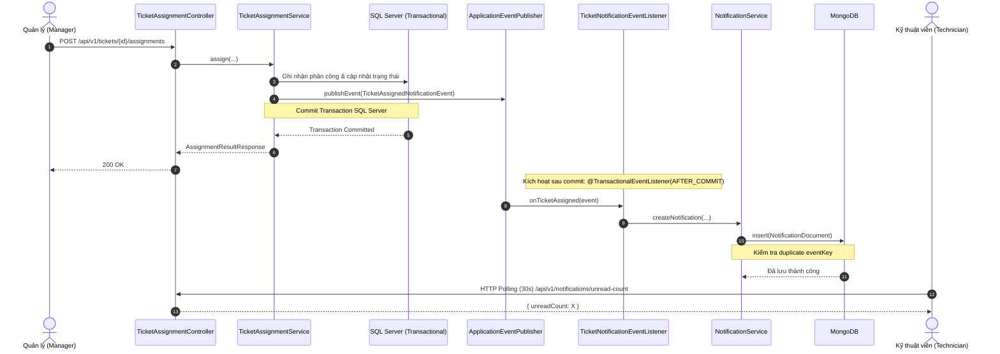
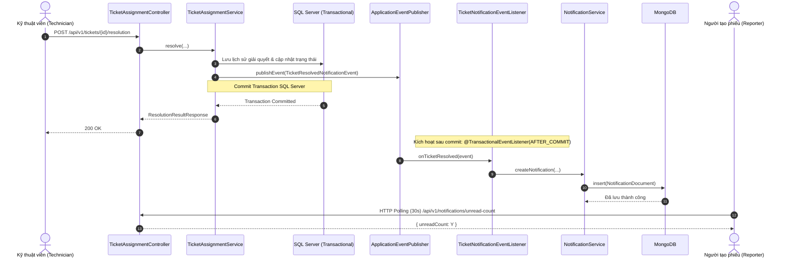

# Tài liệu Thiết kế & Triển khai Hệ thống Thông báo Trong ứng dụng (In-App Notifications)

**Phiên bản:** 1.0.0  
**Branch:** `feat/ticket-in-app-notifications`  
**Người phụ trách:** `OanhPhiTo`  
**Dự án:** Nexora (CampusFix)

---

## 1. Tổng quan Kiến trúc

Hệ thống thông báo trong ứng dụng (In-App Notifications) tích hợp với quy trình xử lý Ticket hiện tại mà không làm thay đổi hay phá vỡ các nghiệp vụ lõi (Assign, Resolve, Close).

```
+-----------------------------------------------------------------------------------------+
|                                    BACKEND (Spring Boot)                                |
|                                                                                         |
|  +-------------------------+      +---------------------------+                         |
|  | TicketAssignmentService | ---> | ApplicationEventPublisher |                         |
|  +-------------------------+      +---------------------------+                         |
|               |                                 |                                       |
|               v (commit)                        v (AFTER_COMMIT)                        |
|  +-------------------------+      +-------------------------------+                     |
|  |       SQL Server        |      | TicketNotificationListener    |                     |
|  | (Tickets & Assignments) |      +-------------------------------+                     |
|  +-------------------------+                    | (bounded retry & idempotent)          |
|                                                 v                                       |
|                                   +-------------------------------+                     |
|                                   |      NotificationService      |                     |
|                                   +-------------------------------+                     |
|                                                 |                                       |
|                                                 v                                       |
|                                   +-------------------------------+                     |
|                                   |            MongoDB            |                     |
|                                   |        (notifications)        |                     |
|                                   +-------------------------------+                     |
+-----------------------------------------------------------------------------------------+
                                                  ^
                                                  | REST API (HTTP Polling 30s)
+-----------------------------------------------------------------------------------------+
|                                  FRONTEND (React)                                       |
|                                                                                         |
|   [AppLayout] -> [NotificationBell] <-> [useNotifications] <-> [notificationApi]        |
|                         |                                                               |
|                         v                                                               |
|               [NotificationDropdown] -> [NotificationItem]                              |
+-----------------------------------------------------------------------------------------+
```

---

## 2. Các Ca sử dụng Nghiệp vụ (Use Cases)

### UC-NOTIF-01: Xem danh sách thông báo
- **Actor:** Người dùng đã đăng nhập (Technician, Requester, Manager, Admin).
- **Mô tả:** Người dùng xem danh sách các thông báo gửi đến mình trong ứng dụng.
- **Tiền điều kiện:** Người dùng đã đăng nhập vào hệ thống với token JWT hợp lệ.
- **Luồng sự kiện chính:**
  1. Frontend gọi định kỳ (30s) `GET /api/v1/notifications/unread-count` để hiển thị số lượng badge chưa đọc trên NotificationBell.
  2. Người dùng nhấp vào NotificationBell. Dropdown mở ra và tải trang thông báo đầu tiên qua `GET /api/v1/notifications?page=0&size=20&unreadOnly=false`.
  3. Người dùng có thể chuyển đổi bộ lọc giữa "Tất cả" và "Chưa đọc" (`unreadOnly=true`).
  4. Người dùng có thể phân trang để xem các trang tiếp theo (`page > 0`).

### UC-NOTIF-02: Đánh dấu thông báo đã đọc và điều hướng
- **Actor:** Người nhận thông báo.
- **Mô tả:** Khi nhấp vào một thông báo, hệ thống đánh dấu thông báo là đã đọc (nếu chưa đọc) và điều hướng người dùng đến trang chi tiết Ticket tương ứng.
- **Luồng sự kiện chính:**
  1. Người dùng nhấp vào một `NotificationItem`.
  2. Nếu thông báo chưa đọc, frontend gửi yêu cầu `PATCH /api/v1/notifications/{notificationId}/read`.
  3. Backend xác thực người dùng hiện tại là chủ sở hữu (`recipientId == currentUser.id`), cập nhật trường `readAt` nguyên tử (atomic), giữ nguyên thời gian đọc ban đầu nếu đã đọc trước đó.
  4. Frontend cập nhật cache optimistic / refetch unread-count và điều hướng đến `/tickets/{ticketId}`.
  5. Đóng dropdown thông báo.

### UC-NOTIF-03: Nhận thông báo khi được phân công Ticket
- **Actor kích hoạt:** Manager / Admin (hoặc hệ thống phân công).
- **Người nhận thông báo:** Kỹ thuật viên (Technician) mới được phân công.
- **Thời điểm phát sinh:** Ngay sau khi transaction phân công trên SQL Server commit thành công (`AFTER_COMMIT`).
- **Nội dung thông báo:**
  - Tiêu đề: `Phân công phiếu yêu cầu #{ticketId}`
  - Tin nhắn: `Bạn được phân công xử lý phiếu #{ticketId}: {ticketTitle}. Vui lòng kiểm tra và xử lý.`
  - Liên kết: Điều hướng trực tiếp đến `/tickets/{ticketId}`.

### UC-NOTIF-04: Nhận thông báo khi Ticket được giải quyết
- **Actor kích hoạt:** Kỹ thuật viên (Technician) xử lý phiếu.
- **Người nhận thông báo:** Người tạo phiếu (Reporter).
- **Thời điểm phát sinh:** Ngay sau khi transaction giải quyết phiếu trên SQL Server commit thành công (`AFTER_COMMIT`).
- **Nội dung thông báo:**
  - Tiêu đề: `Phiếu yêu cầu #{ticketId} đã được giải quyết`
  - Tin nhắn: `Phiếu #{ticketId}: {ticketTitle} đã được xử lý bởi kỹ thuật viên. Bạn có thể kiểm tra kết quả và đóng phiếu.`
  - Liên kết: Điều hướng trực tiếp đến `/tickets/{ticketId}`.

---

## 3. Mô hình Dữ liệu MongoDB (Data Model)

Tài liệu thông báo được lưu trữ trong MongoDB collection `notifications`.

### Cấu trúc Document

| Field | Type | Bắt buộc | Mô tả |
| :--- | :--- | :--- | :--- |
| `_id` | ObjectId | Có | Định danh duy nhất của Document trong MongoDB |
| `recipientId` | Long | Có | ID của người dùng nhận thông báo (từ SQL Server `users.id`) |
| `ticketId` | Long | Không | ID của Ticket liên quan (từ SQL Server `tickets.id`) |
| `eventKey` | String | Không | Mã định danh nghiệp vụ duy nhất (idempotency key) |
| `type` | String | Không | Tên phân loại thông báo (chuỗi) |
| `notificationType`| Enum (`NotificationType`)| Có | Phân loại thông báo: `TICKET_ASSIGNED`, `TICKET_RESOLVED` |
| `title` | String | Có | Tiêu đề thông báo |
| `message` | String | Có | Nội dung thông báo (được escape plain text an toàn) |
| `read` | Boolean | Có | Cờ trạng thái đã đọc (`true`/`false`) |
| `readAt` | Instant | Không | Thời điểm đọc lần đầu. Null khi chưa đọc |
| `createdAt` | Instant | Có | Thời điểm tạo thông báo |
| `legacySqlId` | Long | Không | Khóa tương thích dữ liệu di trú (nếu có) |

### MongoDB Indexes

1. **Unique Idempotency Index (Sparse):**
   ```javascript
   db.notifications.createIndex(
     { "eventKey": 1 },
     { unique: true, sparse: true, name: "uq_notification_event_key" }
   )
   ```
   *Mục đích:* Ngăn chặn tuyệt đối việc tạo trùng thông báo khi sự kiện nghiệp vụ được phát lại hoặc retry nhiều lần.

2. **Compound Index cho Truy vấn & Phân trang Ổn định:**
   ```javascript
   db.notifications.createIndex(
     { "recipientId": 1, "createdAt": -1, "_id": -1 },
     { name: "idx_notif_recipient_created_id" }
   )
   ```
   *Mục đích:* Tối ưu hóa truy vấn danh sách thông báo theo người nhận, sắp xếp mới nhất trước, phân trang ổn định tránh lặp document.

3. **Compound Index cho Lọc Chưa đọc:**
   ```javascript
   db.notifications.createIndex(
     { "recipientId": 1, "readAt": 1 },
     { name: "idx_notif_recipient_unread" }
   )
   ```
   *Mục đích:* Tối ưu hóa truy vấn đếm chưa đọc `countByRecipientIdAndReadAtIsNull` và lọc `unreadOnly=true`.

---

## 4. Đặc tả API Contract (REST)

### 4.1. Lấy danh sách thông báo
- **Endpoint:** `GET /api/v1/notifications`
- **Xác thực:** Yêu cầu Bearer JWT token hợp lệ.
- **Query Parameters:**
  - `page` (int, default: 0, min: 0): Số trang hiện tại.
  - `size` (int, default: 20, min: 1, max: 100): Kích thước mỗi trang.
  - `unreadOnly` (boolean, default: false): Lọc chỉ lấy thông báo chưa đọc.
- **Response 200 OK:**
  ```json
  {
    "content": [
      {
        "id": "6722606553258525e6e65a01",
        "recipientId": 102,
        "ticketId": 1001,
        "eventKey": "TICKET_ASSIGNED:1001:501",
        "type": "TICKET_ASSIGNED",
        "title": "Phân công phiếu yêu cầu #1001",
        "message": "Bạn được phân công xử lý phiếu #1001: Sự cố máy in phòng 302.",
        "createdAt": "2026-10-30T10:15:00Z",
        "readAt": null,
        "read": false
      }
    ],
    "page": 0,
    "size": 20,
    "totalElements": 1,
    "totalPages": 1
  }
  ```
- **Error Codes:**
  - `401 Unauthorized`: Chưa đăng nhập hoặc token hết hạn.
  - `400 Bad Request`: `page < 0` hoặc `size < 1 || size > 100` (trả về RFC 7807 `ProblemDetail`).

### 4.2. Lấy số lượng thông báo chưa đọc
- **Endpoint:** `GET /api/v1/notifications/unread-count`
- **Xác thực:** Yêu cầu Bearer JWT token hợp lệ.
- **Response 200 OK:**
  ```json
  {
    "unreadCount": 3
  }
  ```

### 4.3. Đánh dấu thông báo đã đọc
- **Endpoint:** `PATCH /api/v1/notifications/{notificationId}/read`
- **Xác thực:** Yêu cầu Bearer JWT token hợp lệ.
- **Response 200 OK:**
  ```json
  {
    "id": "6722606553258525e6e65a01",
    "recipientId": 102,
    "ticketId": 1001,
    "eventKey": "TICKET_ASSIGNED:1001:501",
    "type": "TICKET_ASSIGNED",
    "title": "Phân công phiếu yêu cầu #1001",
    "message": "Bạn được phân công xử lý phiếu #1001: Sự cố máy in phòng 302.",
    "createdAt": "2026-10-30T10:15:00Z",
    "readAt": "2026-10-30T10:16:30Z",
    "read": true
  }
  ```
- **Error Codes:**
  - `401 Unauthorized`: Chưa đăng nhập.
  - `404 Not Found`: Không tìm thấy thông báo hoặc thông báo thuộc về người dùng khác (`ProblemDetail`).

---

## 5. Sơ đồ Tuần tự Xử lý Sự kiện (Sequence Diagrams)

### 5.1. Luồng Thông báo Phân công Ticket (Assignment Flow)



### 5.2. Luồng Thông báo Giải quyết Ticket (Resolution Flow)



---

## 6. Cơ chế Retry có giới hạn & Bền vững (Bounded Retry)

Trong mô hình lưu trữ kép (Dual Persistence) giữa SQL Server và MongoDB:
- **Nguyên tắc vàng:** Sự cố ghi MongoDB ở phase sau commit tuyệt đối **không được làm rollback hoặc báo lỗi thất bại** cho nghiệp vụ phân công hoặc giải quyết Ticket đã hoàn tất trên SQL Server.
- **Cơ chế Retry:**
  - `TicketNotificationEventListener` thực hiện bắt ngoại lệ `DataAccessException`, `MongoException`, hoặc lỗi runtime khi ghi vào MongoDB.
  - Bounded retry: Tối đa 3 lần thử (`MAX_RETRIES = 3`).
  - Exponential Backoff: Lần 1: 100ms, Lần 2: 200ms (`INITIAL_BACKOFF_MS * 2^attempt`).
  - Tránh Duplicate: Nhờ vào unique index `eventKey`, khi một lần retry thành công sau khi mạng chập chờn, Document chỉ tồn tại duy nhất một bản ghi.
  - Logging: Ghi log cảnh báo đầy đủ `eventKey`, `ticketId`, `recipientId` và stack trace chi tiết.

---

## 7. Cơ chế Frontend Polling & Quản lý Cache

- **Chu kỳ Polling:** Mặc định 30 giây (`NOTIFICATION_POLL_INTERVAL_MS = 30_000`).
- **Gắn chặt với phiên người dùng:**
  - Polling unread count chỉ được kích hoạt khi `isAuthenticated && user?.id` có giá trị.
  - Khi người dùng đăng xuất (`logout`) hoặc đổi tài khoản, hàm `clearPrivateCache()` trong `AuthProvider` lập tức xóa toàn bộ cache React Query của các thông báo trước đó (`queryClient.removeQueries({ queryKey: ['notifications'] })`).
- **Tối ưu hóa tải:**
  - Danh sách chi tiết thông báo (`notificationsQuery`) chỉ được kích hoạt khi người dùng thực sự mở NotificationDropdown (`enabled: Boolean(isAuthenticated && userId && isOpen)`).
  - Khi dropdown đóng, chỉ truy vấn số lượng chưa đọc hoạt động ở chế độ nền.
- **An toàn nội dung (XSS Prevention):**
  - Thông báo tiêu đề và tin nhắn được render hoàn toàn dưới dạng React text node an toàn (không sử dụng `dangerouslySetInnerHTML`), vô hiệu hóa mọi chuỗi HTML hoặc script độc hại.

