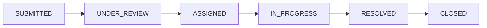
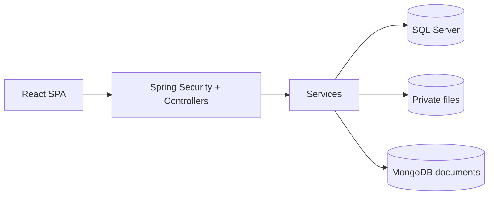
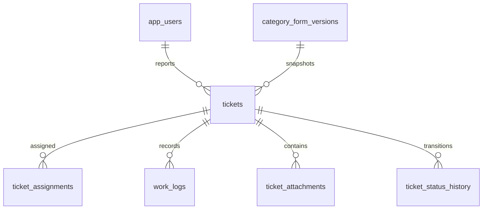

# Nexora — Nội dung thuyết trình và bảo vệ

**18 slide · khoảng 18 phút trình bày/demo + 10 phút Q&A.**

Đây là nội dung slide dạng Markdown theo Part 4.2. Mỗi mục “Slide” tương ứng một trang; ghi chú người nói không cần đưa hết lên màn chiếu. Nhóm điền tên/MSSV và người thực hiện thật theo [báo cáo](PROJECT_REPORT.md).

Ký hiệu người trình bày A–E dưới đây là đề xuất chia phần, không xác nhận phân công. Điều chỉnh theo số thành viên thật; mỗi người phải trình bày/bảo vệ phần mình thực hiện. Không thêm slide phụ làm tổng vượt 20; câu hỏi và checklist cuối file là speaker notes.

## Slide 01 — Nexora: báo cáo và xử lý sự cố campus

**Người nói:** A [điền tên] · **Thời gian:** 30 giây.

- SBA301 – Integrate Single Page Application with Spring Boot.
- Một nơi ghi nhận sự cố, phân công và đối chiếu kết quả.
- Nhóm/lớp/thành viên: [bổ sung thông tin đã xác nhận].

**Ghi chú:** Giới thiệu ngắn mục tiêu và phạm vi demo hiện tại.

---

## Slide 02 — Nhóm và đóng góp thực tế

**Người nói:** A · **Thời gian:** 30 giây.

| Người                            | Phần thực hiện            | Bằng chứng       |
| -------------------------------- | ------------------------- | ---------------- |
| [Tên/MSSV]                       | [Module/chức năng cụ thể] | [PR/commit/test] |
| [Bổ sung các thành viên còn lại] | [Không suy từ tên file]   | [Link thực tế]   |

**Ghi chú:** Nêu ai sẽ giải thích thiết kế, ai chạy demo, ai phụ trách kiểm thử. Dùng phân công đã xác nhận, không chiếu placeholder khi bảo vệ.

---

## Slide 03 — Sự cố cần một luồng theo dõi rõ ràng

**Người nói:** A · **Thời gian:** 45 giây.

- Người báo cần biết phiếu đã được nhận và ai đang xử lý.
- Quản lý cần chọn kỹ thuật viên phù hợp.
- Kết quả cần được đối chiếu trước khi đóng phiếu.

**Ghi chú:** Dùng ví dụ máy chiếu không hoạt động. Đây là case study thiết kế; không khẳng định hiệu quả định lượng khi chưa có khảo sát.

---

## Slide 04 — Giải pháp và ranh giới hiện tại

**Người nói:** A · **Thời gian:** 45 giây.

- React SPA giao tiếp Spring Boot REST API.
- Luồng thật: tạo → review → assign → start → log → ảnh tùy chọn → resolve → close.
- Comments, feedback và các action đang hoãn chưa nằm trong live demo.

**Ghi chú:** Phân biệt dữ liệu/contract đã có với chức năng đã kết nối end-to-end.

---

## Slide 05 — Vai trò không thay thế điều kiện nghiệp vụ

**Người nói:** A · **Thời gian:** 1 phút.

- REQUESTER xem và đóng phiếu của mình.
- TECHNICIAN xem công việc hiện tại/lịch sử, nhưng chỉ ghi khi đúng phân công hiện tại.
- MANAGER/ADMIN review và assign; không upload/close thay chỉ nhờ quyền quản lý.
- Role union vẫn phải thỏa ownership và state.

**Ghi chú:** Minh họa invisible → 404; visible nhưng không được ghi → 403.

---

## Slide 06 — Vòng đời Ticket

**Người nói:** C [điền tên] · **Thời gian:** 1 phút.

- Resolve cần work log và kết quả xử lý.
- Ảnh kết quả là tùy chọn; upload không đổi trạng thái.
- Close cần đúng reporter và không có phân công đang mở.

**Ghi chú:** Không mở rộng sơ đồ thành các action chưa bật để tránh hiểu nhầm demo scope.

---

## Slide 07 — Kiến trúc một backend, một SPA

**Người nói:** B [điền tên] · **Thời gian:** 1 phút.

- Controller xử lý HTTP, service giữ rule/transaction, repository truy cập dữ liệu.
- Chia theo feature để truy vết luồng nghiệp vụ.
- MongoDB lưu document phụ trợ; chưa có notification delivery hoàn chỉnh.

**Ghi chú:** Giải thích vì sao modular monolith phù hợp quy mô bài tập.

---

## Slide 08 — ERD và dữ liệu lịch sử

**Người nói:** D [điền tên] · **Thời gian:** 1 phút.

- 26 bảng ứng dụng SQL; migrations V1–V11 là nguồn chuẩn.
- Ticket giữ form version; attachment metadata và file bytes được lưu riêng.
- FK và unique index bảo vệ quan hệ, service kiểm nghiệp vụ.

**Ghi chú:** ERD đầy đủ ở DATABASE_SCHEMA; chỉ chiếu phần cốt lõi để dễ đọc.

---

## Slide 09 — Biểu mẫu động không làm hỏng Ticket cũ

**Người nói:** B · **Thời gian:** 1 phút.

- Draft được sửa; published/archived giữ nguyên cấu trúc.
- Field/option có validation theo type.
- Ticket cũ luôn đọc form version đã dùng khi tạo.
- Zero/false là giá trị hợp lệ; IMAGE là attachment, không phải scalar answer.

**Ghi chú:** Mở một form published và một Ticket giữ form đó; giải thích publish bản mới không sửa lịch sử.

---

## Slide 10 — Hợp đồng API và đăng nhập

**Người nói:** A · **Thời gian:** 1 phút.

- Bearer JWT; user hiện tại được kiểm trong luồng auth/Ticket.
- DTO thay cho JPA entity; lỗi application/problem+json.
- Query/sort theo allowlist; request ghi có expected version theo contract.
- Upload dùng multipart và không nhận identity/storage key từ client.

**Ghi chú:** Chỉ chọn một request thành công và một lỗi quyền/validation trong Swagger hoặc Network.

---

## Slide 11 — Chống thao tác đồng thời sai

**Người nói:** C · **Thời gian:** 1 phút.

- Expected version phát hiện xác nhận cũ.
- Khóa Ticket giữ kiểm tra trạng thái/phân công cùng transaction.
- Khi cần khóa profile: Ticket → profile.
- SQL Server tests kiểm hai thứ tự upload tranh với resolve hoặc assignment change.

**Ghi chú:** Version xử lý stale request; lock bảo vệ kiểm tra/ghi đồng thời. Không tự retry mutation.

---

## Slide 12 — Lưu ảnh toàn bộ hoặc rollback cả batch

**Người nói:** C · **Thời gian:** 1 phút.

- Chỉ current TECHNICIAN trên IN_PROGRESS.
- 1–5 JPEG/PNG, tối đa 5 MiB/ảnh; kiểm MIME và signature.
- File dùng UUID key; đăng ký rollback cleanup ngay sau store.
- Read/download qua API có quyền; upload không đổi Ticket version/history.

**Ghi chú:** Mở đoạn store → register cleanup → persist. Nêu giới hạn nếu chính filesystem cleanup lỗi.

---

## Slide 13 — Triển khai theo module

**Người nói:** D · **Thời gian:** 45 giây.

- Identity; category/form; Ticket workflow; asset/location/technician; Dashboard.
- Frontend: API module → query/mutation hook → page/component.
- Invalidation sau ghi, khóa nút pending, giữ draft khi upload lỗi.
- Người phụ trách và PR/test: [điền theo đóng góp đã xác nhận].

**Ghi chú:** Chọn một luồng xuyên suốt để giải thích; tránh liệt kê mọi class.

---

## Slide 14 — Kiểm thử có cả trường hợp thất bại

**Người nói:** E [điền tên] · **Thời gian:** 1 phút.

| Bằng chứng 24/10/2026   | Kết quả                           |
| ----------------------- | --------------------------------- |
| Backend verify mặc định | 885 executed passed; 142 skipped  |
| Upload SQL Server       | 41 passed; 1 H2-only case skipped |
| Frontend                | 597 passed                        |
| Lint / production build | Passed                            |

- Có test authorization, validation, rollback và concurrency.
- Chưa có số liệu code coverage; không suy từ số test.

**Ghi chú:** Nêu ngày/commit của lần chạy nộp bài. Đây là mốc bằng chứng, không tự nhận vừa chạy lại.

---

## Slide 15 — Chuẩn bị live demo

**Người nói:** E · **Thời gian:** 30 giây.

- Database/backend đang chạy; production frontend, mock flags false.
- Tài khoản demo ACTIVE theo vai trò.
- Form published, location và kỹ thuật viên eligible đã chuẩn bị.
- Ticket mới và ảnh JPEG/PNG local sẵn sàng.

**Ghi chú:** Mở sẵn các phiên/tab cần thiết; kiểm health và không chiếu token/mật khẩu. Live system là bằng chứng chính.

---

## Slide 16 — Live demo: từ báo sự cố tới đóng phiếu

**Người nói:** Các thành viên theo phần sở hữu · **Thời gian:** 4 phút.

1. REQUESTER tạo Ticket và refresh.
2. MANAGER review, chọn kỹ thuật viên và assign.
3. TECHNICIAN start, lưu work log, upload ảnh rồi refresh.
4. TECHNICIAN resolve.
5. Reporter xem/tải ảnh, close; refresh thấy CLOSED.
6. Mở Dashboard hoặc một lỗi quyền/version để đối chiếu.

**Ghi chú:** Mỗi người nói rõ dữ liệu đã lưu ở đâu và điều kiện bước tiếp theo. Nếu lỗi live, đọc lỗi và xử lý minh bạch; screenshot/log là hỗ trợ, không dùng video thay hệ thống.

---

## Slide 17 — Giới hạn và ưu tiên tiếp theo

**Người nói:** E · **Thời gian:** 45 giây.

- Chưa hoàn thiện các action/collaboration đang tắt.
- File local và MongoDB sau commit cần kế hoạch backup/recovery.
- Chưa có benchmark, khảo sát người dùng hoặc coverage report.
- Ưu tiên hoàn thiện nghiệp vụ và bằng chứng trước khi thêm hạ tầng lớn.

**Ghi chú:** Hướng phát triển phải bám hạn chế quan sát được.

---

## Slide 18 — Kết luận và chuyển sang Q&A

**Người nói:** E · **Thời gian:** 30 giây.

- Luồng SPA–REST–database chính đã kết nối.
- Quyền, lịch sử và concurrency được kiểm bằng test và hệ thống thật.
- Mỗi thành viên sẵn sàng giải thích phần mình thực hiện.
- Repository và tài liệu: [Nexora](https://github.com/TuanThanh-dev19/Nexora).

**Ghi chú:** Chuyển sang khoảng 10 phút Q&A; không kéo phần tổng kết dài.

## Ghi chú bảo vệ — không tính thêm slide

| Câu hỏi dự kiến                                 | Người trả lời          | Điểm cần giải thích                                                  |
| ----------------------------------------------- | ---------------------- | -------------------------------------------------------------------- |
| Vì sao cần service kiểm quyền khi UI đã ẩn nút? | Chủ sở hữu auth/Ticket | Có thể gọi trực tiếp API; quyền đối tượng khác role                  |
| Vì sao form phải có version?                    | Chủ sở hữu category    | Ticket lịch sử không bị đổi nghĩa                                    |
| Version khác lock thế nào?                      | Chủ sở hữu workflow    | Stale request và đồng thời check/write là hai tình huống             |
| File có rollback cùng SQL không?                | Chủ sở hữu upload      | SQL rollback metadata; callback dọn file, có giới hạn                |
| Vì sao dùng hai database?                       | Chủ sở hữu persistence | SQL quan hệ chính, Mongo document phụ; không distributed transaction |
| Test H2 đã đủ chưa?                             | Chủ sở hữu testing     | T-SQL/index/locking cần SQL Server thật                              |
| MSW có chứng minh backend hoạt động?            | Chủ sở hữu frontend    | Không; cần API/database/live evidence                                |
| Phần nào bạn trực tiếp làm?                     | Từng thành viên        | Chỉ rõ PR/commit, code và test do mình thực hiện                     |

Trước ngày bảo vệ: thay toàn bộ placeholder; chốt commit; cập nhật kết quả test; diễn tập trong 18 phút; kiểm links/sơ đồ; chuẩn bị phương án xử lý lỗi môi trường mà vẫn giữ live demo là bằng chứng chính.
