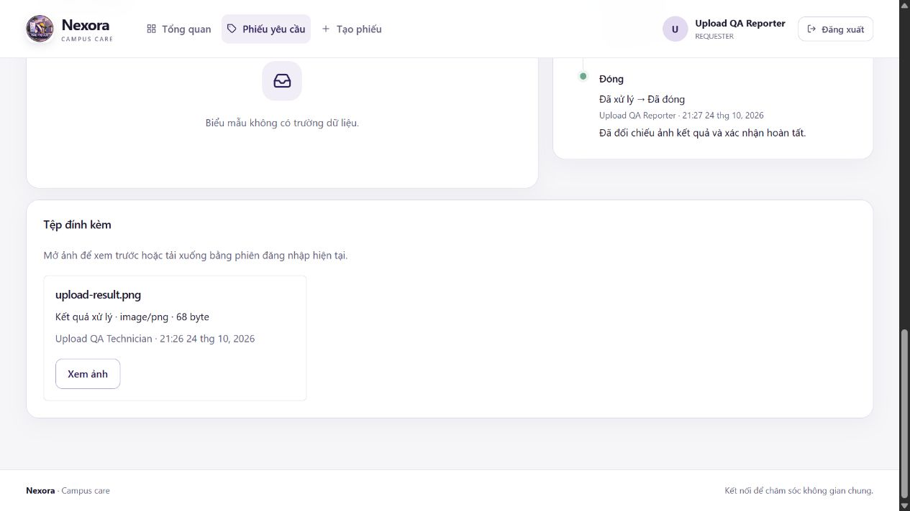

# Báo cáo dự án Nexora

**Môn học:** SBA301 – Integrate Single Page Application with Spring Boot  
**Mốc đối chiếu:** 24/10/2026  
**Lớp / nhóm / giảng viên:** [Nhóm bổ sung]  
**Phiên bản nộp / commit:** [Điền sau khi chốt mã nguồn]

Báo cáo mô tả checkout hiện tại, bao gồm thay đổi upload ảnh kết quả đang ở working tree. Cần điền thông tin nhóm và commit nộp bài trước khi nộp; không coi phần chưa xác nhận là đóng góp thực tế.

## 1. Team Introduction

### 1.1. Giới thiệu

**Nexora** tập trung việc báo cáo sự cố, theo dõi thiết bị và phối hợp bảo trì trong campus. Mục tiêu là để mỗi sự cố có thông tin, người phụ trách, tiến độ và kết quả xử lý rõ ràng trong một hệ thống.

### 1.2. Thành viên và trách nhiệm

Repository chưa cung cấp tên, MSSV hoặc phân công được xác nhận. Năm dòng dưới là khung điền theo các nhóm nghiệp vụ, không phải xác nhận nhóm có đúng năm người hay đã giao việc như bảng.

| Thành viên / MSSV | Vai trò và phần việc cần xác nhận          | Bằng chứng đóng góp      |
| ----------------- | ------------------------------------------ | ------------------------ |
| [Bổ sung]         | Xác thực, tài khoản, vai trò               | [PR/commit/test thực tế] |
| [Bổ sung]         | Category, biểu mẫu động, tạo Ticket        | [PR/commit/test thực tế] |
| [Bổ sung]         | Phân công, nhật ký, xử lý, ảnh kết quả     | [PR/commit/test thực tế] |
| [Bổ sung]         | Địa điểm, thiết bị, cấu hình kỹ thuật viên | [PR/commit/test thực tế] |
| [Bổ sung]         | Dashboard, tích hợp, kiểm thử, tài liệu    | [PR/commit/test thực tế] |

Mỗi người trình bày và trả lời câu hỏi cho phần mình thực sự thực hiện. Nếu nhiều người cùng làm một module, ghi rõ từng phần thay vì chỉ ghi tên module chung.

## 2. Case Study

### 2.1. Bối cảnh và vấn đề

Trong tình huống thiết kế của dự án, sự cố như máy chiếu không hoạt động hoặc thiết bị hỏng cần chuyển từ người phát hiện tới bộ phận vận hành và kỹ thuật viên. Khi thông tin nằm ở nhiều kênh, khó xác định ai đang xử lý, nội dung nào đã được xác minh và khi nào có thể đóng sự cố.

Đây là case study phục vụ thiết kế hệ thống. Nhóm chưa cung cấp khảo sát hoặc số liệu vận hành thực tế; báo cáo không khẳng định đã giảm thời gian xử lý theo một tỷ lệ cụ thể.

### 2.2. Người dùng và giải pháp

| Bên liên quan                        | Nhu cầu                                          | Giải pháp                                            |
| ------------------------------------ | ------------------------------------------------ | ---------------------------------------------------- |
| Người báo, ví dụ sinh viên/nhân viên | Báo đúng địa điểm, theo dõi và đối chiếu kết quả | Tạo Ticket, xem chi tiết, ảnh và đóng phiếu của mình |
| Quản lý vận hành                     | Kiểm tra yêu cầu, chọn người phù hợp             | Review, đánh giá ứng viên, assign và Dashboard       |
| Kỹ thuật viên                        | Biết công việc hiện tại và ghi nhận xử lý        | My Work, start, work logs, ảnh kết quả, resolve      |
| Quản trị viên                        | Chuẩn bị tài khoản và dữ liệu cấu hình           | Quản lý user/role, catalog và biểu mẫu có phiên bản  |

Luồng chính: tạo phiếu → tiếp nhận → phân công → bắt đầu → ghi nhật ký → ảnh kết quả tùy chọn → hoàn tất → người báo đối chiếu → đóng phiếu.

### 2.3. Phạm vi hiện tại

| Phạm vi                                                                                           | Tình trạng                                                                                   |
| ------------------------------------------------------------------------------------------------- | -------------------------------------------------------------------------------------------- |
| Login/JWT, quản trị user/role, catalog, category/form, asset, technician                          | Có controller/service và giao diện tương ứng; kiểm tra theo test của từng module             |
| Tạo/đọc Ticket, review/assign, start/work logs/resolve, upload/đọc ảnh, reporter close, Dashboard, báo cáo Ticket và xuất CSV | Có API thật và được bật cho luồng demo                                                       |
| Reject, cancel, reassign, unassign, reopen, force-close; comments, feedback                       | Chưa bật trong demo; không trình bày là tính năng hoàn chỉnh                                 |
| MongoDB audit/comment/notification documents và legacy backfill                                   | Có tầng lưu trữ; không đồng nghĩa đã có notification delivery hoặc comment UI/API hoàn chỉnh |
| Cloud storage, tự động phân công, phát hiện trùng bằng AI, báo cáo nâng cao                       | Hướng phát triển                                                                             |

## 3. Business Analysis & System Design

### 3.1. Vai trò và quy tắc

| Hành động                                | REQUESTER                  | TECHNICIAN                        | MANAGER / ADMIN                                                |
| ---------------------------------------- | -------------------------- | --------------------------------- | -------------------------------------------------------------- |
| Xem Ticket / ảnh                         | Ticket của mình            | Phân công hiện tại hoặc lịch sử   | Tất cả Ticket                                                  |
| Tạo Ticket                               | Có                         | Cần thêm REQUESTER                | Cần thêm REQUESTER                                             |
| Review / assign                          | Không                      | Không                             | Có                                                             |
| Start / work log / ảnh kết quả / resolve | Không                      | Đúng người đang được phân công    | Cần thêm TECHNICIAN và đúng phân công                          |
| Close                                    | Đúng reporter có REQUESTER | Cần thêm REQUESTER và là reporter | Không được đóng thay chỉ dựa vào vai trò quản lý               |
| Cấu hình hệ thống                        | Không                      | Hồ sơ mình theo quyền đọc         | User/catalog/form: ADMIN; asset/technician: MANAGER hoặc ADMIN |

Tài khoản phải đáp ứng kiểm tra xác thực và trạng thái của nghiệp vụ. Nhiều role mở rộng phạm vi xem, nhưng không bỏ điều kiện sở hữu, phân công hoặc trạng thái. Ticket không tồn tại và Ticket ngoài phạm vi xem dùng cùng phản hồi 404 an toàn.

Các quy tắc trọng tâm:

1. Ticket dùng đúng form đang published khi tạo và giữ form version đó để đọc lịch sử.
2. Địa điểm luôn bắt buộc; asset phải thỏa policy category và điều kiện dữ liệu tham chiếu.
3. Assignment kiểm tra role/trạng thái kỹ thuật viên, availability, capacity, skill và vùng phục vụ. Mỗi Ticket tối đa một phân công còn hiệu lực.
4. Chỉ người được phân công hiện tại bắt đầu, ghi nhật ký, upload hoặc resolve. Resolve cần ít nhất một work log, outcome và summary hợp lệ.
5. Ảnh kết quả là tùy chọn. Upload không thay đổi status, version, resolution hoặc history.
6. Close chỉ cho reporter có REQUESTER khi RESOLVED và không còn assignment đang mở.
7. Cập nhật workflow dùng expected version và khóa SQL trong transaction. History được lưu cùng thay đổi trạng thái.
8. File JPEG/PNG được kiểm MIME và signature, tối đa 5 ảnh/request, 5 MiB/ảnh; metadata không trả storage key hoặc URL công khai.

### 3.2. Thiết kế và công nghệ

Kiến trúc là React SPA gọi Spring Boot REST API theo mô hình modular monolith. Controller xử lý HTTP, service quản lý nghiệp vụ/transaction, repository truy cập dữ liệu và DTO giới hạn dữ liệu trả ra.

SQL Server giữ quan hệ chính; MongoDB giữ document phụ trợ; filesystem giữ bytes ảnh. Xem [sơ đồ kiến trúc và luồng request](ARCHITECTURE.md), [ERD và ràng buộc dữ liệu](DATABASE_SCHEMA.md), [hợp đồng API](API_CONVENTIONS.md).

| Lựa chọn                        | Lý do phù hợp dự án                                                             |
| ------------------------------- | ------------------------------------------------------------------------------- |
| Java 21 / Spring Boot 3.5.16    | REST, Security, validation, JPA và transaction trong cùng ứng dụng              |
| React 19 / JavaScript / Vite    | SPA có component, router, form và build độc lập                                 |
| TanStack Query / Context        | Quản lý dữ liệu server và phiên đăng nhập với trách nhiệm riêng                 |
| SQL Server / Flyway             | FK, unique/index, truy vấn nghiệp vụ và migration có phiên bản                  |
| MongoDB                         | Document audit/comment/notification; tham chiếu SQL bằng ID                     |
| Docker Compose / Testcontainers | Chuẩn bị môi trường và kiểm thử database thật                                   |
| Vitest / Testing Library / MSW  | Kiểm thử logic và tương tác UI; mock không được dùng làm bằng chứng persistence |

### 3.3. Nội dung tự nghiên cứu cần bảo vệ

Các chủ đề có thể dùng cho phần tự nghiên cứu: khóa pessimistic kết hợp optimistic version; immutable form version; rollback file ngoài SQL transaction; sự kiện AFTER_COMMIT sang MongoDB; kiểm thử concurrency bằng Testcontainers.

Đây là các chủ đề có trong mã nguồn. Nhóm cần ghi người thực hiện, tài liệu đã đọc và phần áp dụng thực tế trước khi nhận là đóng góp nghiên cứu của một thành viên.

## 4. Implementation

### 4.1. Các module chính

| Module                | Cách triển khai / điểm vào để giải thích                                                                                                        |
| --------------------- | ----------------------------------------------------------------------------------------------------------------------------------------------- |
| Auth / user           | Spring Security xác minh JWT; AuthService kiểm user hiện tại; BCrypt lưu mật khẩu; ADMIN quản lý user/role                                      |
| Category / form       | Draft được sửa; publish kiểm rule và archive bản cũ trong transaction; Ticket giữ form version                                                  |
| Tạo Ticket            | TicketMultipartReader đọc request nghiêm ngặt; TicketSubmissionValidator kiểm form/file; TicketCreateService lưu Ticket/answer/evidence/history |
| Workflow / technician | TicketAssignmentService dùng khóa Ticket; TechnicianEligibilityService đánh giá ứng viên; work log và resolve kiểm phân công hiện tại           |
| Ảnh kết quả           | TicketAttachmentUploadService khóa Ticket, kiểm visibility/assignee/state, lưu file và metadata; đọc ảnh qua API có phân quyền                  |
| Asset / location      | Entity tham chiếu thống nhất; endpoint quản lý và lịch sử trạng thái; role guard ở API/UI                                                       |
| Dashboard             | Aggregate SQL theo visibility; metric tuần dựa vào resolvedAt và múi giờ Asia/Bangkok                                                           |
| Frontend tích hợp     | Feature API → query/mutation hook → page/component; invalidation sau ghi; draft upload giữ lại khi lỗi                                          |

Đối chiếu chủ sở hữu từng module với bảng thành viên ở phần 1.2. Không dùng bảng kiến trúc để suy ra ai đã viết mã.

### 4.2. Khó khăn và cách xử lý

| Khó khăn                                          | Giải pháp đã có                                                        | Giới hạn cần biết                                              |
| ------------------------------------------------- | ---------------------------------------------------------------------- | -------------------------------------------------------------- |
| Biểu mẫu thay đổi nhưng Ticket cũ phải đọc được   | Giữ form version; published/archived không sửa cấu trúc                | Bản cấu hình cũ không tương thích cần draft sửa và publish mới |
| Hai người cùng thao tác workflow/capacity         | Kiểm expected version; khóa Ticket và technician profile khi cần       | H2 không đủ để chứng minh hành vi SQL Server                   |
| SQL rollback không xóa file tự động               | Đăng ký cleanup ngay sau store; xóa file khi transaction rollback      | Cleanup best effort nếu chính thao tác xóa file cũng lỗi       |
| Quyền xem khác quyền ghi                          | Visibility specification và kiểm role/quan hệ/trạng thái trong service | Guard frontend chỉ hỗ trợ trải nghiệm                          |
| Test UI dùng dữ liệu giả dễ bị nhầm là hoàn chỉnh | Tách mock flags khỏi demoScope; build production loại preview          | Bằng chứng thật vẫn cần API/database/live demo                 |

### 4.3. Code highlights được chọn

Chỉ mở các đoạn liên quan, không trình chiếu toàn bộ file:

- [TicketAttachmentUploadService](../backend/src/main/java/com/nexora/ticket/service/TicketAttachmentUploadService.java): thứ tự kiểm quyền, khóa và đăng ký cleanup.
- [TicketAssignmentService](../backend/src/main/java/com/nexora/ticket/service/TicketAssignmentService.java): điều kiện resolve/close và history cùng transaction.
- [TicketSubmissionValidator](../backend/src/main/java/com/nexora/ticket/service/TicketSubmissionValidator.java): kiểu dữ liệu động, false/zero và validation theo form.
- [useTechnicianWork](../frontend/src/features/tickets/hooks/useTechnicianWork.js): mutation, retry và cache refresh.
- [TechnicianWorkPanel](../frontend/src/features/tickets/components/TechnicianWorkPanel.jsx): preview, pending state, retry/reload.

## 5. Testing

Danh sách test cases, nguồn test và cách chạy nằm trong [TESTING](TESTING.md). Mốc chạy 24/10/2026:

| Kiểm tra                                   | Kết quả đã ghi nhận                                                                           |
| ------------------------------------------ | --------------------------------------------------------------------------------------------- |
| Backend Maven verify                       | 885 test chạy thành công; 142 test bị skip do điều kiện môi trường                            |
| Upload trên H2 + storage unit tests        | 54 thành công, trong đó 42 case upload                                                        |
| Upload trên SQL Server thật                | 41 thành công; 1 case embedded HTTP chỉ chạy trên H2                                          |
| Frontend                                   | 597 thành công / 75 test files                                                                |
| Frontend lint / production build           | Thành công; còn cảnh báo kích thước bundle                                                    |
| Production UI + API trên SQL Server cô lập | Start → work log → upload → refresh → resolve → reporter xem/tải → close → refresh thành công |

Đây là kết quả của lần kiểm thử đã ghi nhận, không phải cam kết mọi lần chạy sau đều có cùng số lượng. Chưa có báo cáo phần trăm code coverage; không quy đổi số test thành tỷ lệ coverage.

Trong smoke test trình duyệt, work log được lưu bằng API thật vì công cụ tự động không nhập được ô datetime hiện có. Upload, refresh, resolve, reporter preview/download và close được kiểm tra bằng UI production.

## 6. Conclusion & Future Work

### 6.1. Kết quả và điểm mạnh

Luồng xử lý chính đã kết nối React với REST API và dữ liệu lưu bền. Hệ thống có phân quyền theo đối tượng, biểu mẫu có phiên bản, kiểm soát cập nhật đồng thời và ảnh kết quả đọc qua phiên đăng nhập. Test kiểm cả dữ liệu sai, người dùng sai quyền, rollback và concurrency thay vì chỉ kiểm trường hợp thành công.

### 6.2. Giới hạn

Comments, feedback và các action đang tắt trong demoScope chưa thuộc luồng demo hoàn chỉnh. File lưu local cần kế hoạch backup khi triển khai nhiều máy. Cleanup file và ghi MongoDB sau commit không phải distributed transaction. Chưa có số liệu hiệu năng, khảo sát người dùng hoặc báo cáo coverage để khẳng định chất lượng vận hành ở quy mô lớn.

### 6.3. Bài học và hướng phát triển

Bài học rút ra từ thiết kế/kiểm thử hiện tại: giữ API contract rõ ràng; kiểm quyền ở service; không sửa dữ liệu lịch sử để phù hợp biểu mẫu mới; kiểm concurrency trên database mục tiêu; phân biệt mock UI với bằng chứng hệ thống thật. Nhóm bổ sung bài học cá nhân có ví dụ cụ thể trước khi nộp.

Ưu tiên tiếp theo: hoàn thiện các action và collaboration còn hoãn; bổ sung coverage/report và kiểm thử khả dụng; backup file/database; sau đó mới cân nhắc cloud storage, thông báo và tối ưu theo số liệu đo.

## 7. Appendix

### 7.1. Repository và vận hành

- [Repository Nexora](https://github.com/TuanThanh-dev19/Nexora).
- [Cài đặt và chạy](SETUP.md); [lệnh kiểm thử và live demo](TESTING.md).
- [Nội dung 18 slide và Q&A](PRESENTATION.md).
- [Migrations V1–V11](../backend/src/main/resources/db/migration/); [backend dependencies](../backend/pom.xml); [frontend dependencies](../frontend/package.json).
- Swagger tại [localhost](http://localhost:8080/swagger-ui.html), OpenAPI JSON tại [localhost](http://localhost:8080/v3/api-docs) khi backend đang chạy.

### 7.2. Bằng chứng hỗ trợ

Ảnh dưới ghi nhận Ticket đã đóng vẫn giữ ảnh kết quả để reporter xem/tải. Đây là bằng chứng hỗ trợ; **live system là bằng chứng demo chính**, không thay bằng video quay sẵn.

Kết quả smoke: Ticket IN_PROGRESS giữ version 2 sau upload; resolve/close đạt CLOSED/version 4; bytes tải xuống trùng ảnh upload. Log đầy đủ của lần chạy nằm ở môi trường local; nhóm cần xuất log đã loại secret và gắn commit khi đóng gói hồ sơ nộp.

### 7.3. Tài liệu tham khảo

- Part 4.1–4.2 của đề SBA301 do người dùng cung cấp trong yêu cầu chuẩn hóa tài liệu. Nhóm bổ sung tên/phiên bản tài liệu môn học chính thức.
- Các cấu hình, migrations và tests của repository là nguồn kiểm chứng hành vi đã triển khai.
- [Spring Boot reference](https://docs.spring.io/spring-boot/3.5/), [React documentation](https://react.dev/learn), [SQL Server documentation](https://learn.microsoft.com/en-us/sql/sql-server/), [MongoDB documentation](https://www.mongodb.com/docs/), [Testcontainers for Java](https://java.testcontainers.org/).

## Mở rộng NEX-054 (#95): Search and Filter Tickets

Tại danh sách Ticket, nhập “Tìm theo mã hoặc tiêu đề”, nhấn Enter hoặc Tìm kiếm. Từ khóa mới đưa page về 0 và giữ status/priority/location/sort. Từ khóa áp dụng nằm trong URL để refresh/chia sẻ; trang chi tiết chuyển tiếp listSearch để quay lại đúng kết quả. Đặt lại bộ lọc xóa cả keyword. Khi request mới đang tải, không dùng bảng kết quả từ từ khóa trước; query key theo viewer và toàn bộ URL cùng AbortSignal ngăn response cũ ghi đè.

Demo: tìm một phần mã; tìm tiêu đề tiếng Việt khác hoa/thường kết hợp trạng thái/ưu tiên; chuyển trang → chi tiết → quay lại; tìm chuỗi không tồn tại hiển thị 0 phiếu. Requester không tìm thấy mã chính xác của người khác; Technician chỉ thấy phạm vi assignment hiện tại/lịch sử; tài khoản nhiều role giữ hợp quyền. My Work không có tìm kiếm mới. Tìm mô tả, tìm không dấu, full-text và gợi ý tự động ngoài phạm vi.

Contract và cách escape LIKE: [API_CONVENTIONS.md](API_CONVENTIONS.md). Các ca tìm Unicode, wildcard, quyền, kết hợp bộ lọc/phân trang chạy cùng TicketReadApiContract trên H2 và SQL Server; UI test URL/Enter/reset/chi tiết/quay lại và request race.
